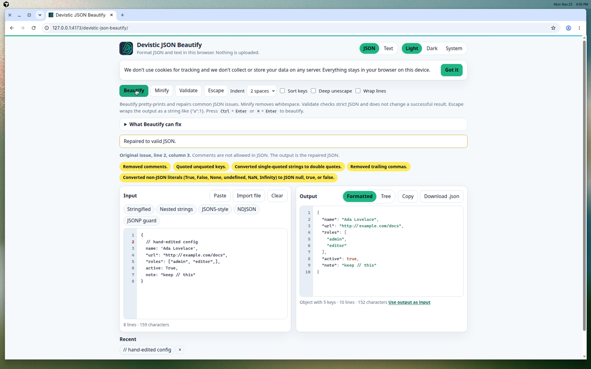
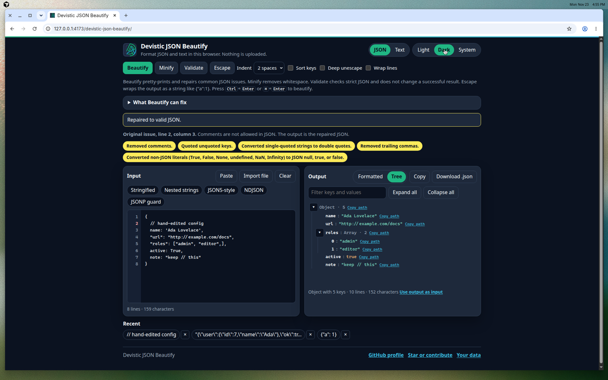
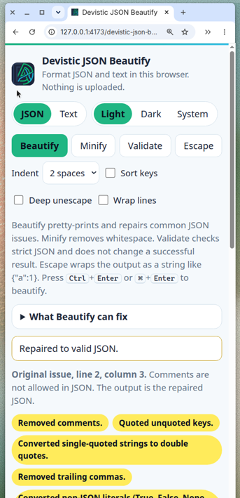

# Devistic JSON Beautify

A free, one-page JSON and text formatter that runs entirely in your browser. Paste a messy API response, repair it, and inspect it as formatted text or a collapsible tree. Nothing is uploaded.

**Live app:** https://devistic-asim.github.io/devistic-json-beautify/

GitHub Pages serves the `main` branch from the Actions workflow. The repository owner needs **Settings → Pages → Source = GitHub Actions** before that URL goes live.







## Features

JSON

- Beautify with 2 spaces, 4 spaces, or tabs, and minify
- Unwrap stringified and multiply-escaped JSON, including values nested inside other JSON when Deep unescape is on
- Repair trailing commas, comments, single quotes, unquoted keys, and a few non-JSON literals, then say what changed
- Combine NDJSON into one array
- Strip a JSONP callback or a `while(1);`, `for(;;);`, or `)]}'` prefix
- Validate with a plain-language message, line, and column
- Tree with expand, collapse, filter, and copy path
- Sort keys, escape the result back to a JSON string, copy, and download `.json`

Text

- Trim lines, collapse spaces, remove blank lines, and normalize line endings
- UPPERCASE, lowercase, Capitalize Each Word, and Sentence case
- camelCase, snake_case, and kebab-case, one line at a time
- Paste, copy, import `.txt`, and download the result

The page remembers your draft, recent inputs, indent, and theme in local storage. You can export a JSON backup or recent inputs as NDJSON, import that backup, or clear the local data.

## How to use

1. Paste JSON, or import a `.json`, `.txt`, or `.ndjson` file. The example chips load the cases the repair handles.
2. Press **Beautify**. Yellow notes explain each automatic fix. **Validate** checks strict JSON and leaves a successful result alone.
3. Switch the output to **Tree** to collapse branches and copy a path such as `$.user.id`.
4. Turn on **Deep unescape** when a string value is itself JSON. Turn it off to keep that text as a string.
5. **Escape** wraps the output as a quoted JSON string. Switch to **Text** for case and identifier tools.
6. Open **Your data** in the footer to export, import, or delete what this browser stored.

`Ctrl`+`Enter` (or `⌘`+`Enter`) beautifies JSON or cleans text.

## Tech stack

- Vite, React, and TypeScript
- Vitest for the parser, unescape, repair, and text transforms
- ESLint in CI
- No backend, no analytics, no third-party fonts or trackers

The repair ideas come from using [jsonformatter.org](https://jsonformatter.org/) (format, tree, local draft), [JSONLint](https://jsonlint.com/) (line and column, plain-language errors), [JSON Crack](https://jsoncrack.com/) (collapse and expand instead of a crowded graph), and [CyberChef](https://gchq.github.io/CyberChef/) (tolerant parse, sort keys, escape and unescape). The implementation in this repo is original.

## Run locally

```bash
npm install
npm test
npm run dev
```

`npm run build` writes `dist/` with base path `/devistic-json-beautify/` and copies `index.html` to `404.html`. `npm run preview` serves that build.

## Privacy

We don't use cookies for tracking and we don't collect or store your data on any server. Everything stays in your browser on this device.

Theme, settings, the current draft, and recent inputs are stored in `localStorage` under `devistic-json-beautify`. **Your data → Clear my local data** removes them.

## Contributing

See [CONTRIBUTING.md](CONTRIBUTING.md) and the [Code of Conduct](CODE_OF_CONDUCT.md).

## License

[MIT](LICENSE) © devistic-asim

## Contact

https://github.com/devistic-asim
